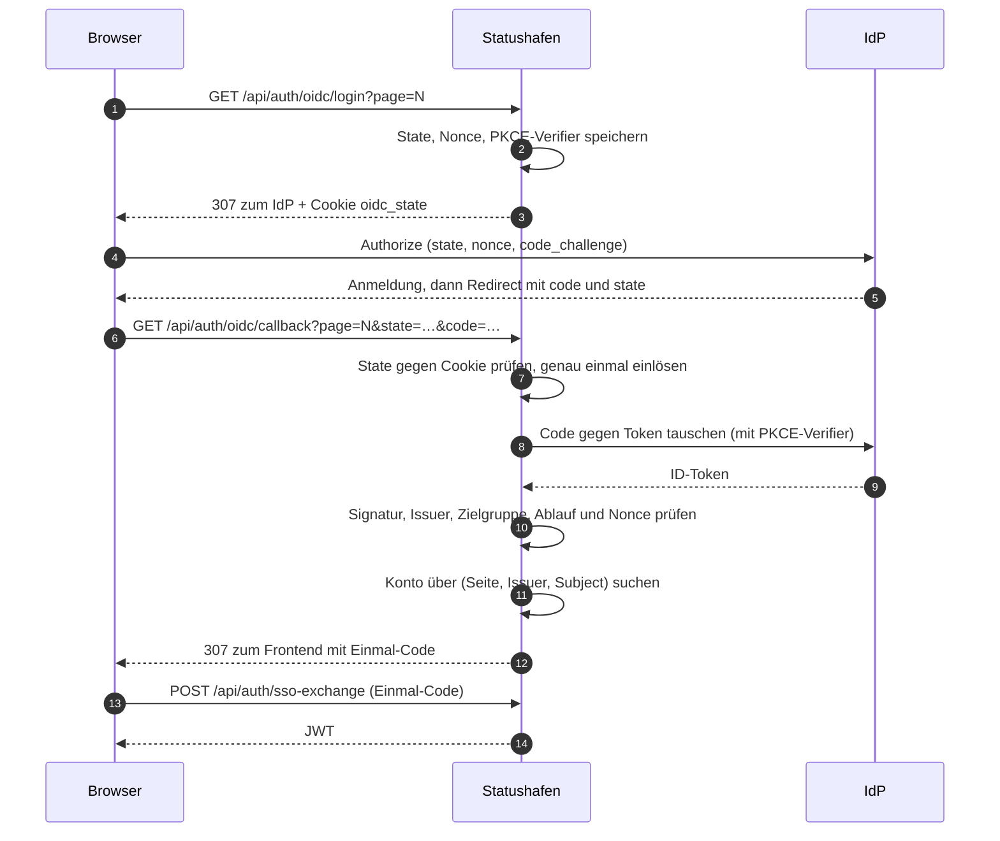
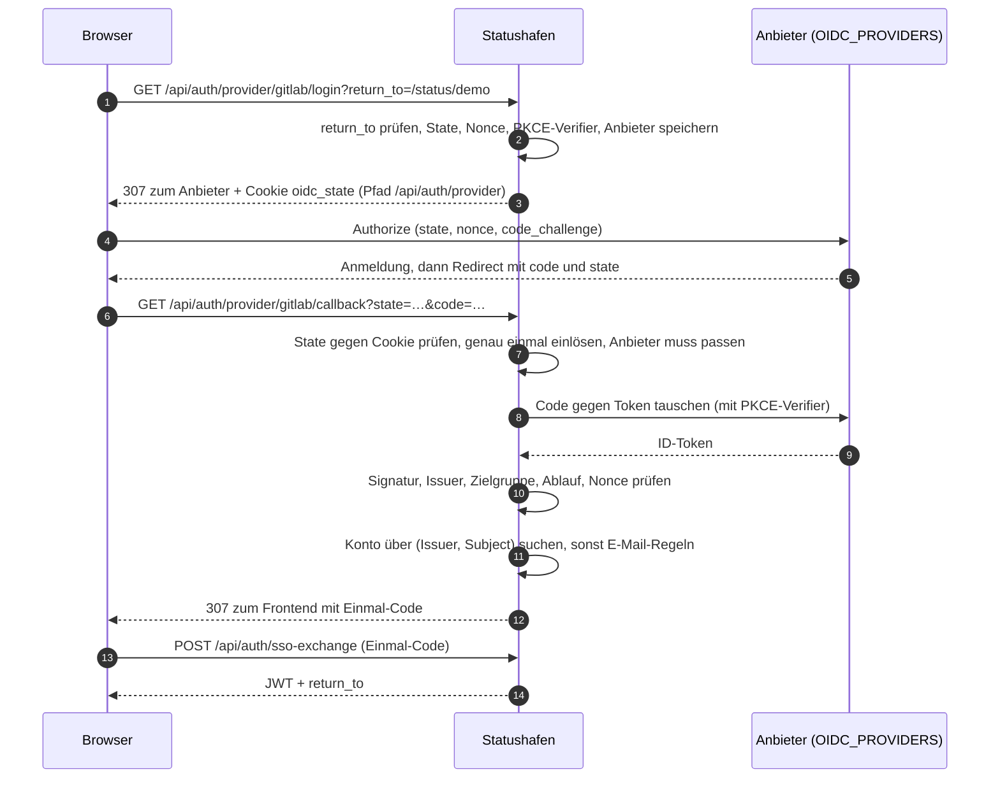
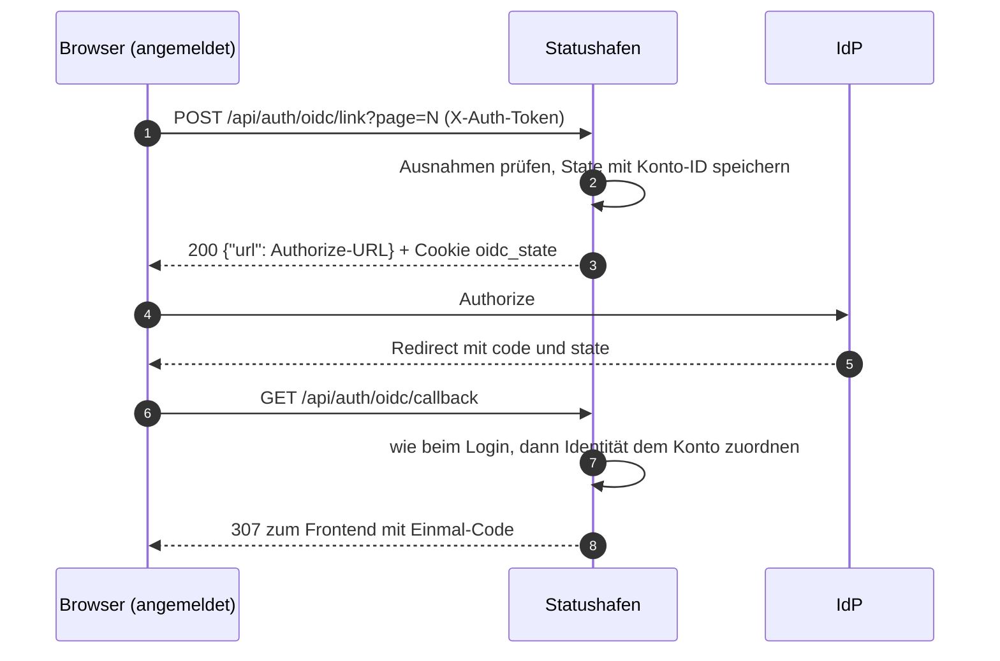
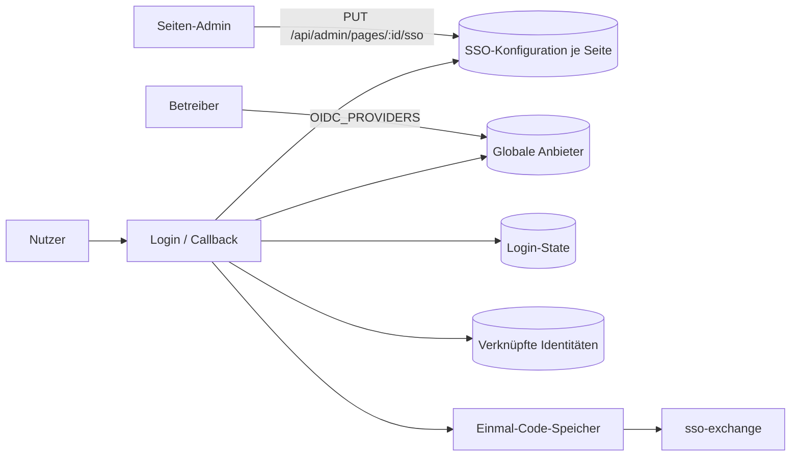

# SSO-Architektur

Ablauf der Anmeldung über globale OIDC-Anbieter und des Seiten-SSO je Statusseite. Endpunkte und Fehler stehen in der
[API](api.md), die Einrichtung unter [Globale Anbieter](providers.md) und im [OIDC-Guide](oidc.md).

## Login mit OIDC

Das JWT steht nie in einer URL: Der Browser bekommt nur den kurzlebigen Einmal-Code, den das Frontend
einlöst. Das Konto wird nie über die E-Mail-Adresse gefunden. Das JWT gilt nur für diese Seite
().

## Login über einen globalen Anbieter

Das JWT gilt für das ganze Konto (kein `sso_page_id`). Ein bestehendes Konto wird beim ersten Login
nur mit `email_verified=true` über die E-Mail verknüpft (Regeln: [Globale Anbieter](providers.md#konten)).

## Verknüpfung eines bestehenden Kontos

Bei Global Admins oder Konten mit Rolle auf einer anderen Seite lehnt schon der Link-Aufruf mit `403`
ab. Gehört die Identität bereits einem anderen Konto, leitet der Callback mit dem Code
`already_linked` ins Profil zurück.

## Bedrohungsmodell

Vertrauensgrenzen:

1. **Browser ↔ Backend**: Alles aus dem Browser ist unvertrauenswürdig (Query `state`, `code`,
   `return_to`, Cookies, Einmal-Code). Das Backend vertraut nur eigenen, in der Datenbank
   gespeicherten Login-States.
2. **Backend ↔ IdP**: Globale Anbieter konfiguriert der Betreiber (vertrauenswürdig, auch interne
   Adressen erlaubt); den IdP eines Seiten-SSO pflegt ein Seiten-Admin (eingeschränkt vertrauenswürdig:
   SSRF-Schutz, Sitzung nur für diese Seite, keine E-Mail-Zuordnung). Antworten des IdP gelten erst
   nach Prüfung des ID-Tokens.

STRIDE:

| Kategorie | Bedrohung | Gegenmaßnahme |
| --- | --- | --- |
| Spoofing | Fremdes ID-Token, Token eines anderen Issuers oder Clients | Signatur über das JWKS, `iss`, `aud`, `exp`, Nonce aus dem State; leeres `sub` abgelehnt. |
| Spoofing | Konto-Übernahme über eine gleichlautende E-Mail | Verknüpfung per E-Mail nur bei `email_verified=true` und nur bei globalen Anbietern; Seiten-SSO nie per E-Mail. |
| Spoofing | Login-CSRF (eigener Code im Browser des Opfers) | State an HttpOnly-Cookie gebunden, Vergleich in konstanter Zeit. |
| Tampering | Manipulierter oder fremder State, State eines anderen Anbieters | State nur aus der Datenbank, genau einmal einlösbar (`DELETE … RETURNING`), 10 Minuten gültig, Anbieter/Seite muss zum Callback passen. |
| Tampering | Abgefangener Code beim Anbieter | PKCE (S256) mit Verifier nur im Backend. |
| Repudiation | Unbemerkte Anmeldungen | Audit-Einträge `auth.sso_login`/`auth.sso_linked` mit Anbieter. |
| Information Disclosure | JWT in URL, History, Referrer | Nur kurzlebiger Einmal-Code in der URL, JWT per `POST /api/auth/sso-exchange`; Code genau einmal. |
| Information Disclosure | Geheimnisse im Log | Client-Secrets werden nie geloggt; Fehlertexte werden bereinigt (`logging.SanitizeErr`). |
| Information Disclosure | Open Redirect über `return_to` | Nur ein Pfad mit genau einem `/` (auch nach Dekodieren), keine Steuerzeichen, Leerzeichen, Backslashes, nicht `/api`, höchstens 2048 Byte; sonst verworfen. Das Ziel geht nur als JSON ans Frontend. Fehler-Redirects nutzen nur `FRONTEND_URL` und feste Codes. |
| Denial of Service | Viele Login-Starts, langsame IdPs | Rate-Limits (20/min Login/Callback, 10/min Exchange, 60/min Auth-Config), Zeitgrenzen der HTTP-Clients, Discovery-Cache mit Negativ-Cache, abgelaufene States werden gelöscht. |
| Elevation of Privilege | Seiten-IdP verschafft globale Rechte | Seiten-SSO-Sitzungen gelten nur für ihre Seite und dürfen keinen globalen Anbieter verknüpfen; Global Admins nutzen kein Seiten-SSO. |
| Elevation of Privilege | Start-Admin über unbestätigte E-Mail | `SSO_BOOTSTRAP_ADMIN_EMAILS` greift nur mit `email_verified=true` und der E-Mail des Kontos. |
| Elevation of Privilege | Passwort-Login trotz Abschaltung | `POST /api/login` und alle Passwort-Setz-Endpunkte antworten `403 password_login_disabled`. |

Missbrauchsfälle als Go-Tests: `handlers/return_to_test.go`, `handlers/oidc_global_test.go`
(State, Nonce, Issuer, Client-ID, `email_verified`, Domains, unbekannte Anbieter),
`handlers/password_login_test.go`, `main_sso_removed_routes_test.go`.

## Bausteine

