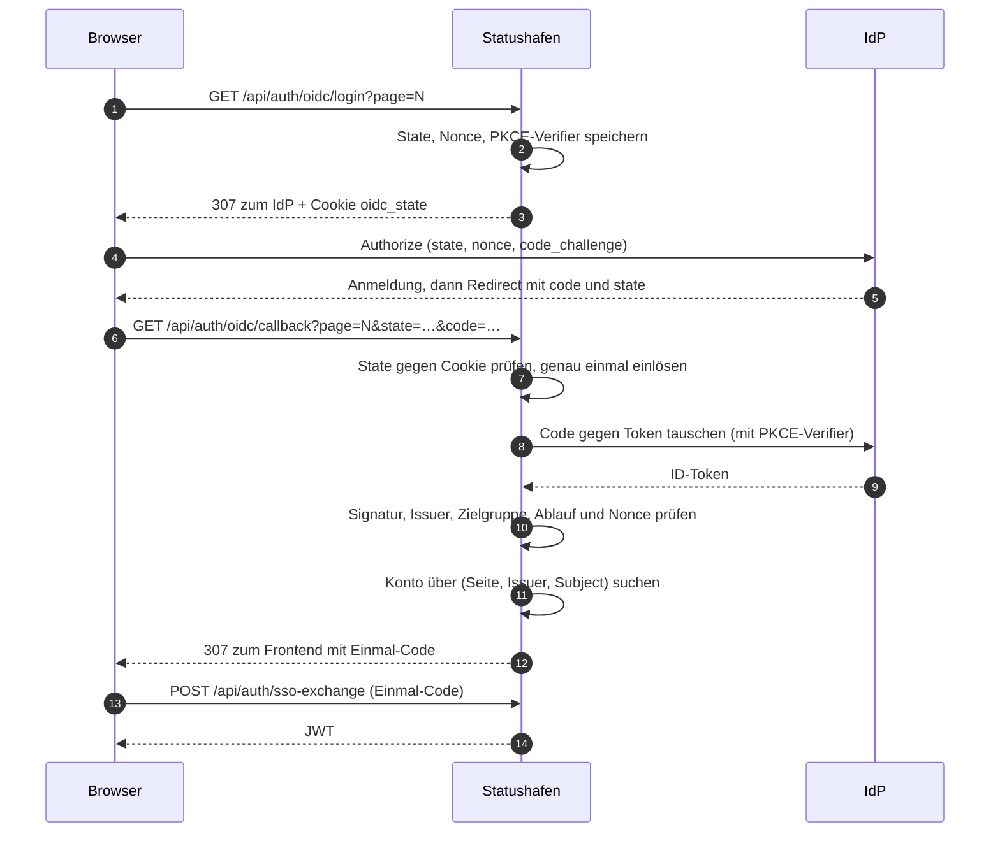
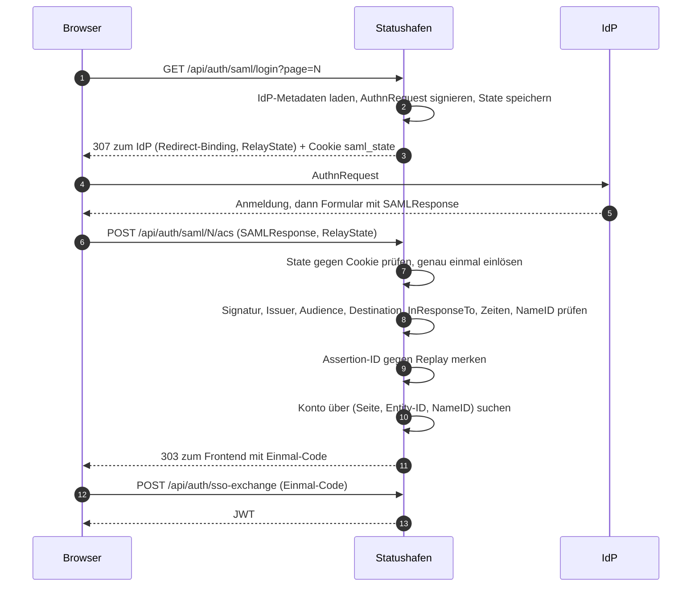
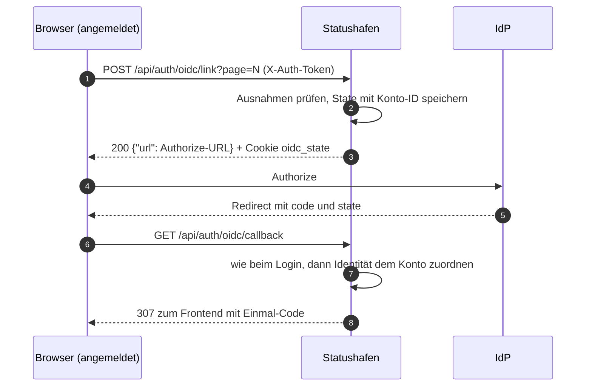
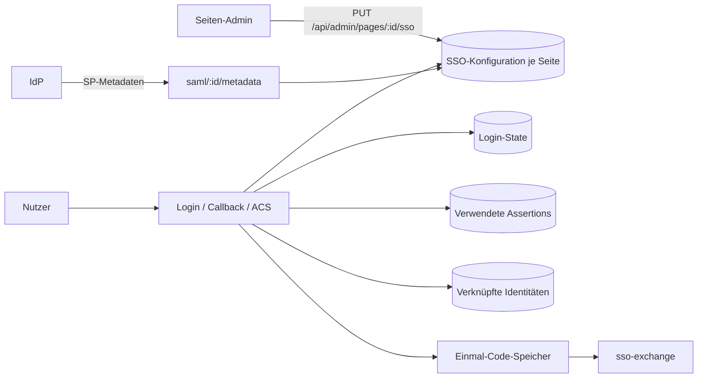

# SSO-Architektur

Ablauf des Seiten-SSO (OIDC und SAML) je Statusseite. Endpunkte und Fehler stehen in der
[API](api.md), die Einrichtung im [OIDC-Guide](oidc.md) bzw. [SAML-Guide](saml.md).

## Login mit OIDC

Das JWT steht nie in einer URL: Der Browser bekommt nur den kurzlebigen Einmal-Code, den das Frontend
einlöst. Das Konto wird nie über die E-Mail-Adresse gefunden. Das JWT gilt nur für diese Seite
().

## Login mit SAML

IdP-initiierte Anmeldungen gibt es nicht: Jede Antwort muss zu einem eigenen AuthnRequest passen.

## Verknüpfung eines bestehenden Kontos

Bei SAML läuft die Verknüpfung genauso über `POST /api/auth/saml/link?page=N` und den ACS.

Bei Global Admins oder Konten mit Rolle auf einer anderen Seite lehnt schon der Link-Aufruf mit `403`
ab. Gehört die Identität bereits einem anderen Konto, leitet der Callback bzw. ACS mit dem Code
`already_linked` ins Profil zurück.

## Bausteine

