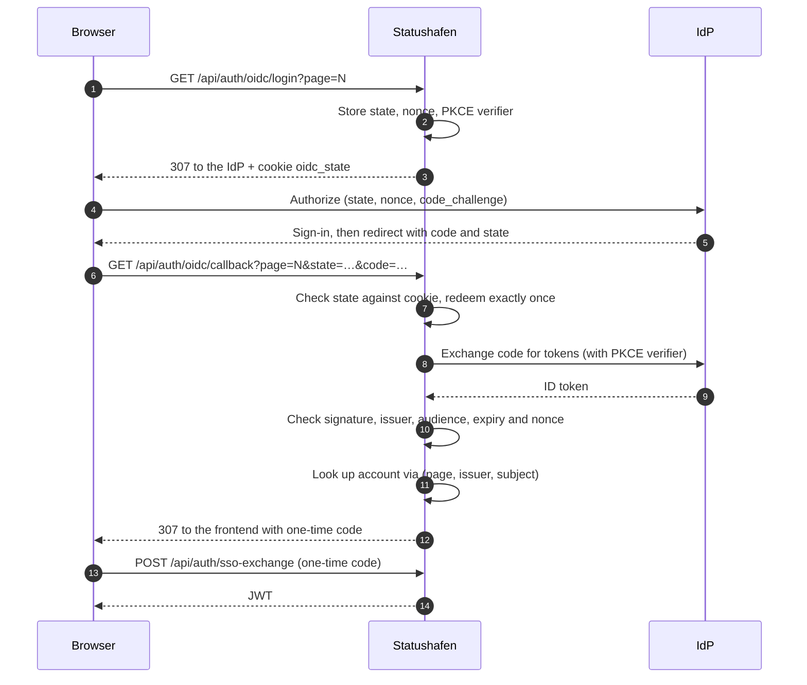
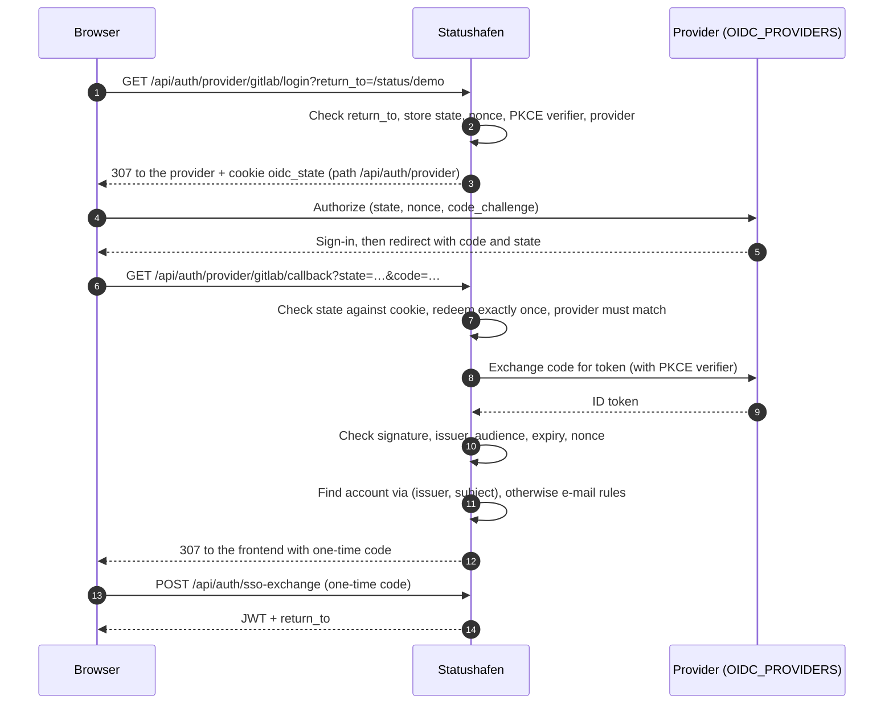
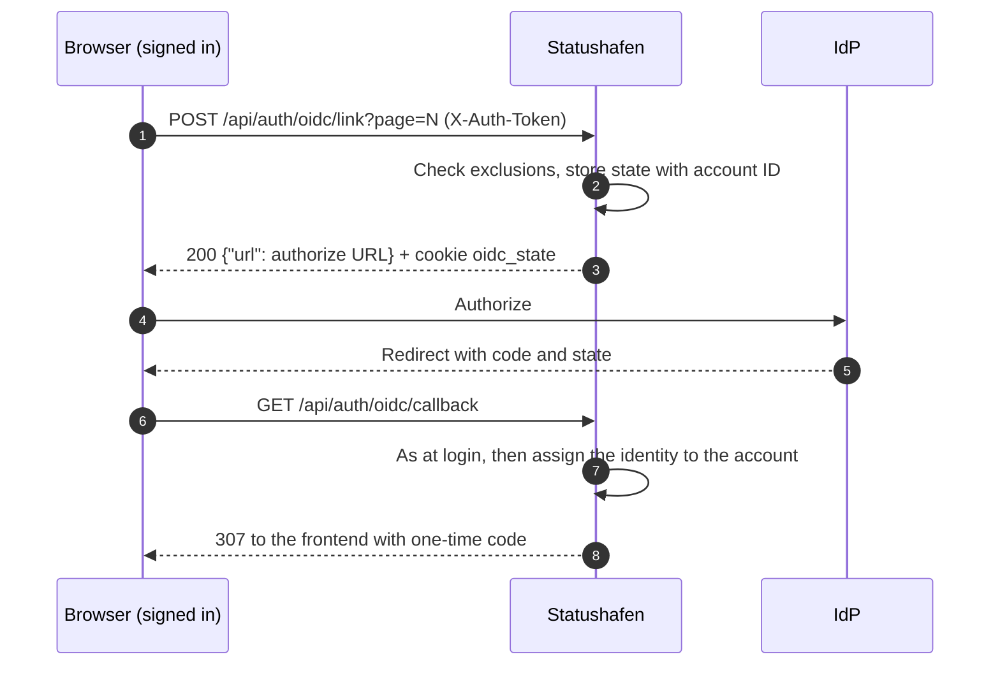
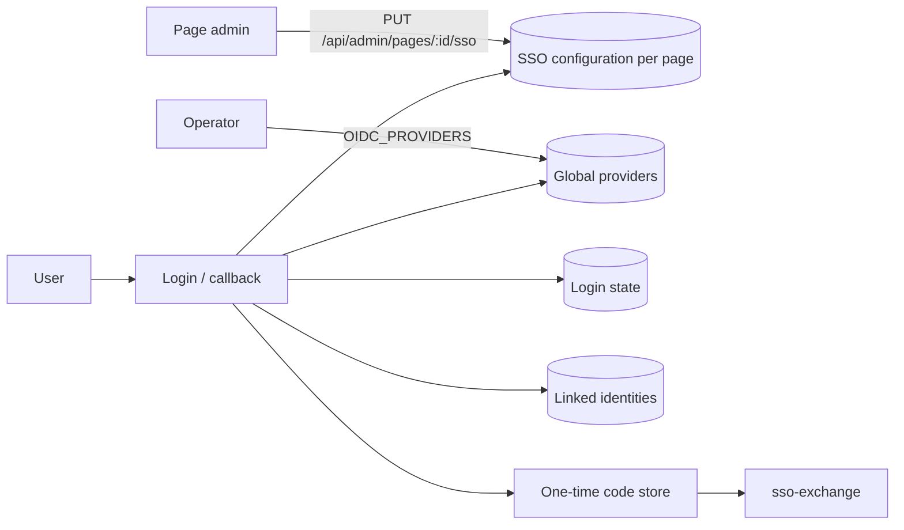

# SSO architecture

> English version of the German document [`../architecture.md`](../architecture.md).

Flow of the sign-in through global OIDC providers and of the page SSO per status page. Endpoints and errors are in the
[API](api.md), the setup under [Global providers](providers.md) and in the [OIDC guide](oidc.md).

## Login with OIDC

The JWT is never in a URL: the browser only receives the short-lived one-time code, which the
frontend redeems. The account is never found through the email address. The JWT is valid for this
page only.

## Login through a global provider

The JWT applies to the whole account (no `sso_page_id`). An existing account is linked by e-mail on
the first login only with `email_verified=true` (rules: [Global providers](providers.md#accounts)).

## Linking an existing account

For global admins or accounts with a role on another page, the link call already rejects with
`403`. If the identity already belongs to another account, the callback redirects back to
the profile with the code `already_linked`.

## Threat model

Trust boundaries:

1. **Browser ↔ backend**: everything from the browser is untrusted (query `state`, `code`,
   `return_to`, cookies, one-time code). The backend only trusts its own login states stored in the
   database.
2. **Backend ↔ IdP**: global providers are configured by the operator (trusted, internal addresses
   allowed); the IdP of a page SSO is maintained by a page admin (partly trusted: SSRF protection,
   session for that page only, no e-mail matching). IdP answers count only after the ID token has
   been verified.

STRIDE:

| Category | Threat | Countermeasure |
| --- | --- | --- |
| Spoofing | Forged ID token, token of another issuer or client | Signature via the JWKS, `iss`, `aud`, `exp`, nonce from the state; empty `sub` refused. |
| Spoofing | Account takeover through a matching e-mail | Linking by e-mail only with `email_verified=true` and only for global providers; page SSO never by e-mail. |
| Spoofing | Login CSRF (attacker's code in the victim's browser) | State bound to an HttpOnly cookie, constant-time comparison. |
| Tampering | Manipulated or foreign state, state of another provider | State only from the database, redeemable exactly once (`DELETE … RETURNING`), valid for 10 minutes, provider/page must match the callback. |
| Tampering | Intercepted code at the provider | PKCE (S256) with the verifier kept in the backend. |
| Repudiation | Unnoticed sign-ins | Audit entries `auth.sso_login`/`auth.sso_linked` with the provider. |
| Information disclosure | JWT in URL, history, referrer | Only a short-lived one-time code in the URL, JWT via `POST /api/auth/sso-exchange`; code exactly once. |
| Information disclosure | Secrets in the log | Client secrets are never logged; error texts are sanitized (`logging.SanitizeErr`). |
| Information disclosure | Open redirect via `return_to` | Only a path with exactly one `/` (also after decoding), no control characters, whitespace, backslashes, not `/api`, at most 2048 bytes; otherwise dropped. The target only reaches the frontend as JSON. Error redirects use `FRONTEND_URL` and fixed codes only. |
| Denial of service | Many login starts, slow IdPs | Rate limits (20/min login/callback, 10/min exchange, 60/min auth config), timeouts of the HTTP clients, discovery cache with negative cache, expired states are deleted. |
| Elevation of privilege | Page IdP grants global rights | Page SSO sessions apply to their page only and may not link a global provider; global admins do not use the page SSO. |
| Elevation of privilege | Bootstrap admin via unverified e-mail | `SSO_BOOTSTRAP_ADMIN_EMAILS` applies only with `email_verified=true` and the account's e-mail. |
| Elevation of privilege | Password login despite being switched off | `POST /api/login` and all password-setting endpoints answer `403 password_login_disabled`. |

Abuse cases as Go tests: `handlers/return_to_test.go`, `handlers/oidc_global_test.go` (state, nonce,
issuer, client ID, `email_verified`, domains, unknown providers), `handlers/password_login_test.go`,
`main_sso_removed_routes_test.go`.

## Building blocks

