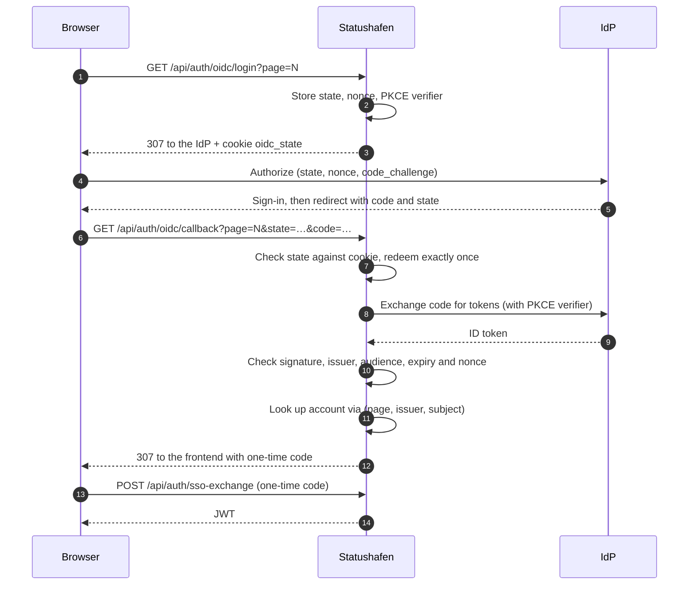
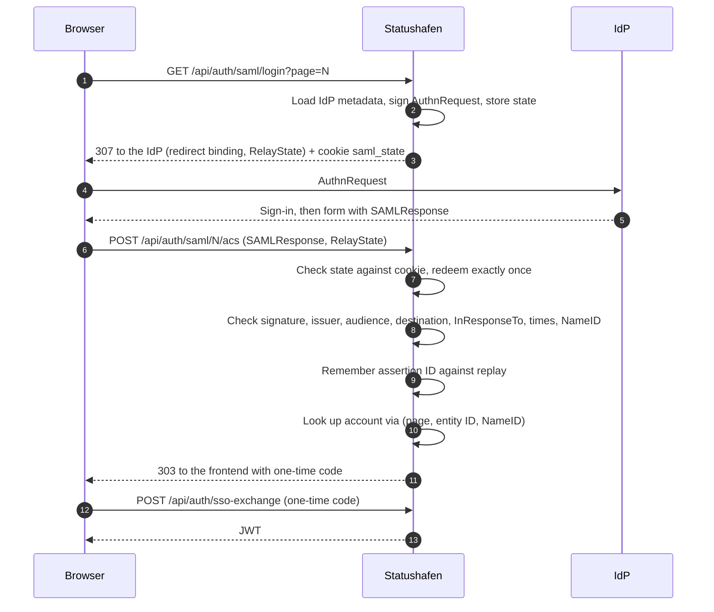
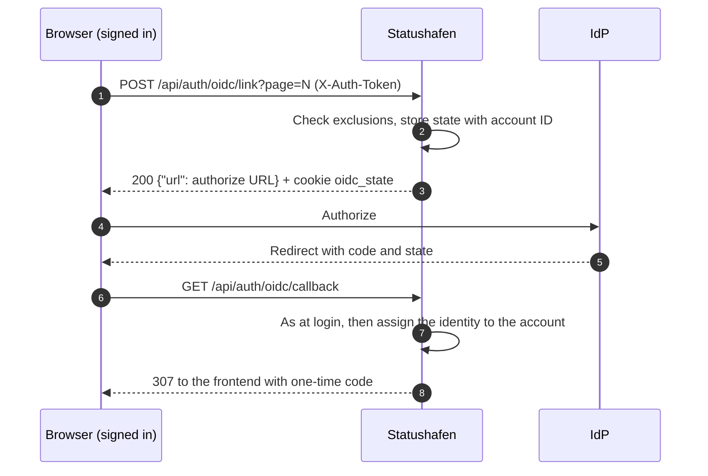
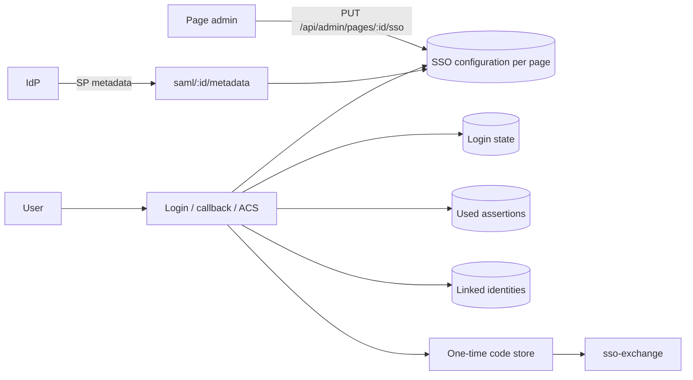

# SSO architecture

> English version of the German document [`../architecture.md`](../architecture.md).

Flow of the page SSO (OIDC and SAML) per status page. Endpoints and errors are in the
[API](api.md), the setup in the [OIDC guide](oidc.md) and [SAML guide](saml.md).

## Login with OIDC

The JWT is never in a URL: the browser only receives the short-lived one-time code, which the
frontend redeems. The account is never found through the email address. The JWT is valid for this
page only.

## Login with SAML

There is no IdP-initiated sign-in: every response must match an AuthnRequest of its own.

## Linking an existing account

For SAML, linking works the same way via `POST /api/auth/saml/link?page=N` and the ACS.

For global admins or accounts with a role on another page, the link call already rejects with
`403`. If the identity already belongs to another account, the callback or ACS redirects back to
the profile with the code `already_linked`.

## Building blocks

